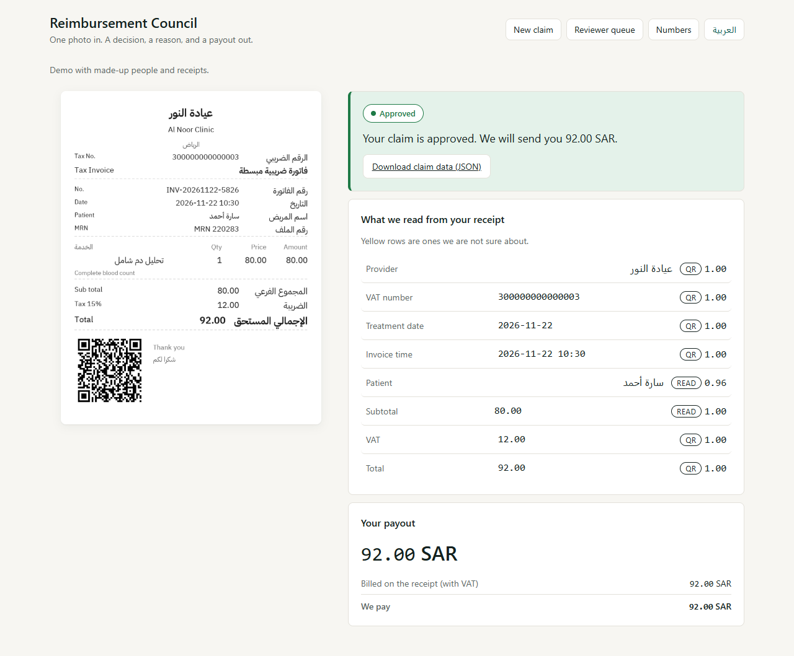
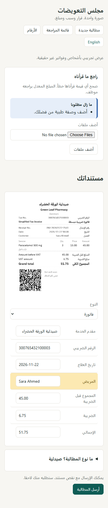

# Reimbursement Council

Health insurance reimbursement claims that decide themselves when it is safe, ask the member to fix what is missing, and give a human reviewer one clear card when it is not.

Built for the Solve for Bupa hackathon, November 2026 (brief: docs/brief/project-brief.md). Not affiliated with or using any Bupa systems or data. Every person, clinic and receipt in the demo is made up.



## What it does

1. The member uploads their documents (photos, scans or PDFs): the invoice or receipt, and the prescription or medical report the claim needs. Nothing is typed.
2. Each document is read offline by a local vision AI model and by OCR at the same time (the ZATCA QR code is the truth). The model only reads: every value must be found on the document or the QR, or it is dropped (docs/MODEL_SAFETY.md).
3. A check step shows what was read, names any missing document or mismatch (another patient's name, another date), and lets the member correct a value. The member fixes it before the claim is sent, not days later.
4. Hard rules (late, not covered, duplicate, ...) can reject. A council of checks scores the rest, and the claim goes to one lane: approved, asked to fix one thing, or a person with every piece of evidence on one card.
5. Every decided claim exports as structured JSON with a published schema (docs/INTEGRATION.md), ready for a claims system.



## The idea in one picture

```
 Member documents (invoice or receipt, prescription, medical report; photo, scan or PDF)
     |
     v
 Read each -- ZATCA QR first, then offline OCR, then arithmetic checks;
     |        find each document's type and what the claim still needs
     v
 Check ------ the member sees what was read, adds what is missing, fixes
     |        mistakes; patient and dates must agree across documents
     v
 Hard rules -- yes or no veto (late, not covered, duplicate, ...)
     |
     v
 Council ----- document, coverage, price, history checks,
     |         each gives a weighted score from 0 to 1
     v
 Decide ------ calibrated score, disagreement, expected loss vs review cost
     |
     +--> auto approve (full or partial)
     +--> self-fix: the member adds the exact missing thing, or picks a person
     +--> human review: one card with all the evidence
     +--> auto reject: only on a confident hard rule
     |
     v
 Export ------ JSON valid against schemas/claim-export.schema.json
```

## Run it (Windows, macOS or Linux)

Needs [uv](https://docs.astral.sh/uv/), which installs Python 3.12 by itself. The `ocr` extra adds EasyOCR and PyTorch (a large download).

```
uv sync --extra ocr
uv run pytest
uv run reimbursement-council serve
```

Open http://127.0.0.1:8000, tick the consent box and press a demo claim. The site reads the demo files in the background at start (about a minute the first time each day); `GET /api/ready` says when it is done. The default reader needs [Ollama](https://ollama.com) running with `ollama pull qwen3-vl:8b-instruct`; `--reader easyocr` starts it with OCR only, `--reader qr_only` without OCR. The live demo steps are in docs/DEMO.md.

## Numbers

Every number we show is in docs/pitch/numbers.md with the command, commit and test set that produced it. In short: on synthetic claims no approval was wrong and no payable claim was rejected; on 60 real scanned receipts (SROIE) the reader gets the date on about half and the total and shop name on about a third, so on real documents it asks the member instead of guessing.

## Other commands

- `make-claims --count 60 --seed 12 --out data/sets/check`, then `run-set data/sets/check` (add `--set KEY=VALUE` to change one switch, `--simulate-fix` to act as the member in self-fix): synthetic claims with known right answers, scored.
- `export-set FOLDER --out outputs/export`: decide and export every claim in a set, each checked against the schema.
- `read-sroie data/real/sroie` and `make-real-claims data/real/sroie --out data/sets/real_e2e`: score the reader on real receipts and run them end to end.
- `write-schema`: write the export JSON Schema again after changing the model.
- `uv run pytest -m e2e`: a real browser goes through the demo path (Playwright).
- `uv run --no-sync python -m tests.e2e.screenshots`: screenshots of every screen into screenshots/.

Generated data and caches live in data/ and outputs/, which are not committed.

## Code map

```
config/                   every weight, threshold, cost, switch and member message (YAML)
schemas/                  the claim export JSON Schema
reimbursement_council/
  config/                 load and validate config/*.yaml and env vars
  core/                   pure logic: money, ZATCA QR, parsing, rules, payout, council,
                          lanes, cross checks, export, privacy masking
  adapters/               readers (QR, OCR, PDF), SQLite store, files, drawing, schema check
  pipeline/               process_claim and export_claim wire the stages together
  synthetic/              synthetic claims with right answers, harness metrics
  evaluation/             real receipts (SROIE) scoring and claim context
  web/                    the website (FastAPI): thin routes, templates, one CSS file
  cli/                    commands
tests/                    mirrors the package; tests/e2e drives the website in a browser
```

## Docs

- Design: docs/superpowers/specs/2026-11-23-reimbursement-council-design.md and docs/superpowers/specs/2026-11-24-document-set-design.md
- Integration (the export, field by field, and a FHIR R4 mapping): docs/INTEGRATION.md
- Numbers and experiments: docs/pitch/numbers.md, docs/EXPERIMENTS.md
- Project summary: docs/SUMMARY.md
- Decisions: docs/decisions/
- Where things stand: docs/HANDOVER.md
